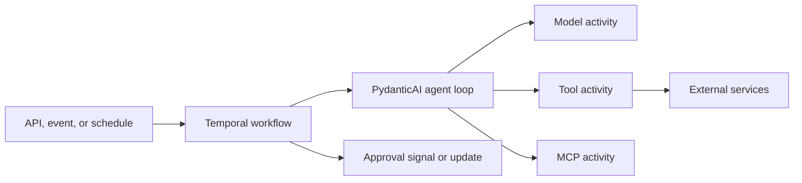

# SDK notes

SDK-specific passages cut from the Playbooks when they became technology-neutral, kept verbatim with their source headings. Relative links point at their old locations in the Playbooks repository.

## Agent playbook: SDK-specific passages removed during neutralization

Passages below were removed or rewritten in `agent-playbook/` and are preserved
verbatim for relocation to Zetra. Chapters 6, 12 and `references.md` are not
included because their originals were already copied to Zetra.

### README.md — opening paragraph

> This playbook defines a production standard for building AI agents with [PydanticAI](https://pydantic.dev/docs/ai/) and [Temporal](https://docs.temporal.io/). It treats an agent as a governed software system: a typed contract, a constrained set of capabilities, a durable execution model when required, and measurable quality, safety, reliability, and cost.

### README.md — Executable guidance

> The companion [Agent Development Skills](../skills/README.md) translate this standard into focused workflows for Claude Code, Codex, and compatible Agent Skills clients. [`agentctl`](../tools/agentctl/README.md) provides the executable golden path for scaffolding, Agent Spec, risk-contract, and skill validation, eval adapters, provenance, and release gates.

### README.md — The standard in one page

> 2. Uses a PydanticAI Agent Spec for its declarative definition and Python types for runtime validation.
> 5. Uses Temporal for long-running work or any externally visible side effect.

Execution-class table column was `Temporal`; side-effect column read "Allowed through activities".

### 1. Principles and scope — Scope

> The standard applies to production agents built with PydanticAI, including agents exposed through APIs, user interfaces, background jobs, schedules, and event-driven workflows.

### 1. Principles and scope — Declarative intent, typed enforcement

> Use a PydanticAI Agent Spec to declare identity, instructions, model defaults, retry budgets, timeouts, capabilities, and metadata. Use Python and Pydantic types to enforce runtime inputs, dependencies, outputs, policies, and tool contracts.

### 1. Principles and scope — Durable side effects

> Any agent that can modify external state MUST run through Temporal. Model requests and I/O execute as activities; deterministic coordination executes in workflows.

### 2. Reference architecture — Repository structure (Python layout)

```text
project/
├── .agents/
│   └── skills/                       # Skills for coding/development agents
├── pyproject.toml
├── src/<package>/
│   ├── agents/
│   │   └── <agent_name>/
│   │       ├── agent.yaml
│   │       ├── factory.py
│   │       ├── dependencies.py
│   │       ├── models.py
│   │       ├── instructions/
│   │       ├── skills/               # Private runtime skills
│   │       └── tools/                # Private tools
│   ├── skills/                       # Shared runtime skills
│   ├── tools/                        # Shared executable capabilities
│   │   ├── common/
│   │   └── <domain>/
│   ├── workflows/
│   ├── activities/
│   ├── runtime/
│   ├── observability/
│   ├── policy/
│   └── settings.py
├── evals/
...
```

> - Runtime Agent Skills belong under `src/<package>/skills/` or the agent package.

### 2. Reference architecture — Runtime architecture



### 2. Reference architecture — Build and packaging

> - Tests MUST load resources from the built wheel or equivalent deployment artifact.
> - Runtime resource paths SHOULD be resolved with `importlib.resources`, not a process working-directory assumption.

### 3. Canonical agent contract — Agent Spec (PydanticAI-specific fields)

The original Agent Spec example included PydanticAI Agent Spec top-level fields:

```yaml
retries: 2
tool_timeout: 20
end_strategy: graceful
instrument: true
```

> Organization-specific fields belong under `metadata` and MUST be validated by application code during startup.

### 3. Canonical agent contract — Typed dependencies

```python
from dataclasses import dataclass
from datetime import datetime
from uuid import UUID


@dataclass(frozen=True)
class SupportDependencies:
    request_id: UUID
    tenant_id: UUID
    actor_id: UUID
    authorization_scopes: frozenset[str]
    deadline: datetime
```

> They MUST NOT contain model-generated authorization, mutable global state, raw secrets, or objects that will be serialized unsafely into Temporal history. Pass serializable identifiers across workflow boundaries and reconstruct infrastructure clients within activities.

### 3. Canonical agent contract — Typed output

> Production agents SHOULD use a Pydantic output type:

```python
from typing import Literal
from pydantic import BaseModel, Field


class Evidence(BaseModel):
    source: str
    claim: str


class SupportResolution(BaseModel):
    status: Literal[
        "answered",
        "action_proposed",
        "needs_information",
        "escalated",
    ]
    summary: str
    evidence: list[Evidence]
    confidence: float = Field(ge=0, le=1)
    proposed_action: str | None = None
```

> An Agent Spec `output_schema` guides model output but returns a plain dictionary rather than providing the same runtime validation as a typed `output_type`. Typed output is therefore the production default.

### 3. Canonical agent contract — Factory responsibilities / Versioning

> 6. Attaches usage, spend, observability, and Temporal capabilities.

> - Worker/build version: executable and Temporal compatibility.
>
> Behavior-changing edits to instructions, models, skills, tools, or outputs require an agent version change and relevant evals. Temporal-incompatible changes additionally require replay-safe deployment.

### 4. Skill standard

> PydanticAI exposes Agent Skills as deferred capabilities: the model initially sees their names and descriptions and loads full instructions when relevant.

> PydanticAI automatically loads `SKILL.md`; it does not automatically read or execute bundled references, scripts, or assets. A skill MUST NOT assume those resources are available unless the application supplies a reviewed resource-loading capability.

Structure root was `src/<package>/skills/`.

Selection (PydanticAI Agent Spec capability syntax):

```yaml
capabilities:
  - Skills:
      directories: src/acme_agent/skills
      include:
        - customer-policy
        - incident-triage
```

### 5. Tool standard — Retry classification

```python
from enum import StrEnum
from pydantic import BaseModel


class ToolEffect(StrEnum):
    READ = "read"
    WRITE_REVERSIBLE = "write_reversible"
    WRITE_CONSEQUENTIAL = "write_consequential"


class RetrySafety(StrEnum):
    SAFE = "safe"
    IDEMPOTENCY_KEY_REQUIRED = "idempotency_key_required"
    UNSAFE = "unsafe"


class ToolPolicy(BaseModel):
    name: str
    owner: str
    effect: ToolEffect
    retry_safety: RetrySafety
    authorization_scopes: set[str]
    timeout_seconds: float
    data_classification: str
```

### 5. Tool standard — Recommended structure

```text
src/<package>/tools/
├── common/
│   ├── errors.py
│   ├── policy.py
│   └── telemetry.py
└── crm/
    ├── models.py
    ├── service.py
    ├── tools.py
    ├── toolset.py
    └── policy.py
```

### 5. Tool standard — Temporal and side effects

> For durable agents:
>
> - Tool I/O executes in activities.

### 7. Evaluation standard — Evaluator hierarchy

> Pydantic Evals supports output assertions, duration limits, tool correctness, trajectory matching, argument correctness, model/tool-call limits, span-based evaluation, and online evaluation.

Evaluators directory listed `deterministic.py`, `quality.py`, `trajectory.py`, `safety.py`, `operational.py`, `temporal.py`. Evaluation layer row: "Temporal scenarios". Hard gate: "Temporal replay passes." CI: "Main branch: broad offline and Temporal tests."

### 8. Observability standard

> Observe the agent as an application, not merely as model calls. The standard is vendor-neutral and based on OpenTelemetry. Pydantic Logfire is a supported first-party backend, not a mandatory dependency.

> PydanticAI emits agent, model, and tool spans. Temporal emits workflow and activity telemetry. Because these may execute in different processes and at different times, every span MUST also carry stable logical correlation identifiers.

Original Temporal attributes:

```text
temporal.namespace
temporal.task_queue
temporal.workflow_type
temporal.workflow_id
temporal.run_id
```

> Tool spans record tool name, toolset ID, effect, call ID, activity attempt, ...

Redaction list included "Temporal payloads".

### 9. Cost optimization standard — Budget hierarchy

> Use PydanticAI `UsageLimits` for run-level requests, tools, tokens, and cost. Use shared `SpendLimits` storage for budgets spanning runs or workers. In-memory spend counters are insufficient for a production worker fleet or a durable workflow that may resume elsewhere.

### 9. Cost optimization standard — Prompt caching / Retry economics / Durable-workflow economics

> Long Temporal waits may outlive a provider cache; resumed-workflow estimates SHOULD assume a miss unless observed otherwise.

```text
semantic attempts
× Temporal activity attempts
× provider transport attempts
× model fallbacks
```

> The default under Temporal is bounded semantic retries, bounded activity retries, disabled provider transport retries, limited fallback candidates, and idempotent side effects.

> - Use `Continue-As-New` for long histories.

### 10. Security and governance

> PydanticAI Harness features used by this playbook may be on `0.x` releases; production projects SHOULD pin versions, review release notes, and run full compatibility evals before upgrades.

Change class row: "Temporal-sensitive | Replay tests, versioning/patch plan, compatible worker retention".

> Rollback plans MUST account for active Temporal histories; retaining compatible workers may be necessary even after routing new work to an earlier build.

### 11. Production readiness — Temporal

> - [ ] Durable runs execute inside workflows.
> - [ ] All I/O executes in activities.
> - [ ] Workflow and activity identifiers are stable.
> - [ ] Timeouts and retry policies are bounded.
> - [ ] Provider transport retries are disabled or justified.
> - [ ] Cancellation and compensation are defined.
> - [ ] Payloads and histories are bounded.
> - [ ] Replay tests pass.
> - [ ] Compatible worker deployment is planned.

> - [ ] Temporal durability scenarios pass.

### 13. Agent risk assessment — Executable contract

> The companion `agentctl` package publishes the canonical Draft 2020-12 JSON
> Schema and adds semantic checks that JSON Schema cannot express, including the
> risk matrix, maximum-tier summaries, governance floors, prohibited-use and
> critical-residual decisions, duplicate identifiers, date ordering, assessment
> references, and verified evidence for claimed risk reduction.

```bash
# Validate every canonical assessment in a project.
scripts/agentctl risk validate --root /path/to/project

# Validate or explain a specific artifact.
scripts/agentctl risk validate docs/risk-assessments/customer-support.yaml
scripts/agentctl risk explain docs/risk-assessments/customer-support.yaml
scripts/agentctl risk explain docs/risk-assessments/customer-support.yaml \
  --format json
```

> `agentctl validate` applies the same contract through the Agent Spec reference
> and additionally checks that the agent name, agent version, execution class,
> and governance tier agree across both artifacts.

> Acceptable evidence includes ... Temporal replay and failure scenarios, ...

### templates/risk-assessment.yaml

Control evidence originally referenced a Python test file:

```yaml
        evidence:
          - tests/security/test_tenant_isolation.py
          - evals/cases/AUTH-021.yaml
```

## Multi-Agent Playbook: SDK-specific passages removed

Passages removed from `multi-agent-playbook/` during the technology-neutral rewrite, preserved verbatim with their source headings.

### 05-delegation-and-interactions.md > Delegation envelope

```python
from datetime import datetime
from typing import Literal

from pydantic import BaseModel, Field


class BudgetGrant(BaseModel):
    max_model_requests: int = Field(gt=0)
    max_tool_calls: int = Field(ge=0)
    max_input_tokens: int = Field(gt=0)
    max_output_tokens: int = Field(gt=0)
    max_cost_usd: float = Field(gt=0)


class DelegationEnvelope(BaseModel):
    contract_version: int
    system_name: str
    system_version: str
    manifest_id: str
    system_run_id: str
    interaction_id: str
    delegation_id: str
    parent_delegation_id: str | None
    mode: Literal["delegate", "handoff", "review", "fanout", "vote", "dispatch"]
    caller: str
    caller_version: str
    callee: str
    callee_version: str
    actor_id: str
    tenant_id: str
    authorization_scopes: frozenset[str]
    objective: str
    input_schema: str
    input: dict
    evidence_refs: list[str]
    data_classification: str
    budget: BudgetGrant
    depth: int = Field(ge=0)
    attempt: int = Field(gt=0)
    deadline: datetime
    trace_context: dict[str, str]
    approval_id: str | None = None
```

### 05-delegation-and-interactions.md > Result envelope

```python
class InteractionResult(BaseModel):
    delegation_id: str
    status: Literal[
        "completed",
        "needs_information",
        "rejected",
        "policy_blocked",
        "budget_exhausted",
        "timeout",
        "cancelled",
        "failed_retryable",
        "failed_permanent",
    ]
    output_schema: str
    output: dict | None
    evidence_refs: list[str]
    performed_effects: list[str]
    unresolved_questions: list[str]
    model_requests: int
    tool_calls: int
    input_tokens: int
    output_tokens: int
    cost_usd: float | None
```

### 02-reference-architecture.md > Repository structure (Python layout excerpt)

```text
project/
├── src/<package>/
│   ├── agents/                         # Agent Playbook packages
│   │   └── <agent_name>/
│   │       └── agent.yaml
│   ├── systems/
│   │   └── <system_name>/
│   │       ├── system.yaml
│   │       ├── factory.py
│   │       ├── models.py
│   │       ├── coordination.py
│   │       └── policies/
│   │           ├── delegation.yaml
│   │           ├── data-flow.yaml
│   │           └── termination.yaml
│   ├── workflows/
│   ├── activities/
│   ├── runtime/
│   ├── observability/
│   └── policy/
```

### 07-evaluation.md > Dataset structure (evaluator modules excerpt)

```text
├── evaluators/
│   ├── deterministic.py
│   ├── outcome.py
│   ├── graph.py
│   ├── interaction.py
│   ├── safety.py
│   ├── operational.py
│   └── temporal.py
```

### 03-system-contract.md and templates/system-spec.yaml > metadata

Originally `temporal_enabled: true` and `approval_policy: src/acme_agents/policy/approvals/customer_resolution.yaml`; the agentctl schema (tools/agentctl/src/agentctl/schemas/system-spec.schema.json) still requires `temporal_enabled`.
